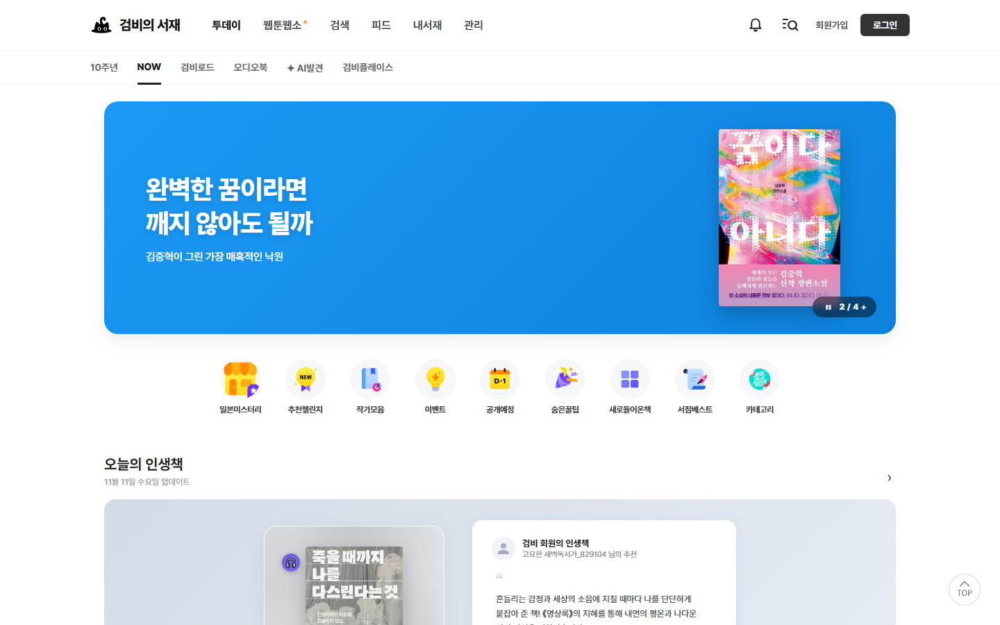
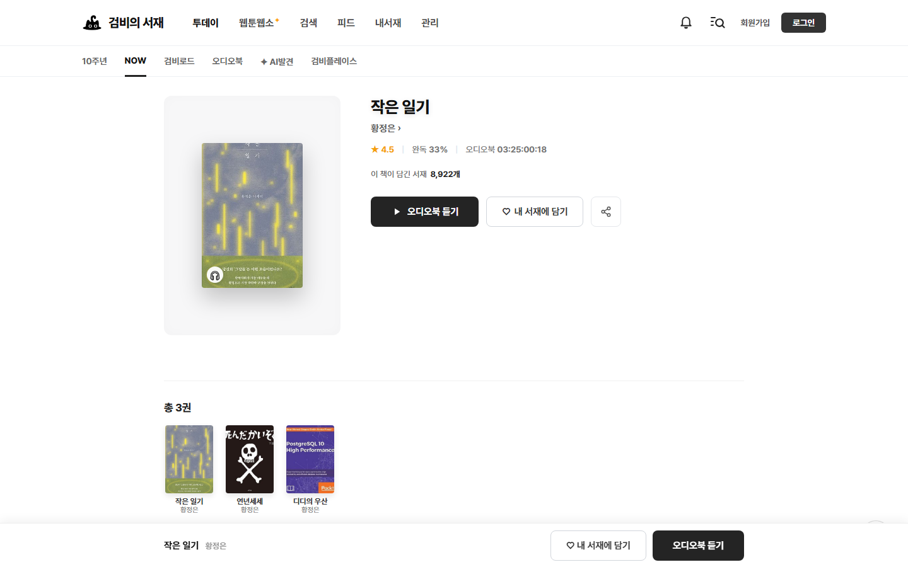

# 검비의서재 · Gumbi Books

> **README 구조 개편:** 2026-11-16 · 기존 설명·명령·이미지·원저작자 표기를 보존하고, 제품·의사결정·검증 기준으로 재배열했습니다. **이번 작업에서는 앱이나 테스트를 재실행하지 않았습니다.** 기재된 성과는 원본 README의 주장입니다.

**읽는 순서:** 0~2 제품 설명 → 3~4 설계 판단 → 5~8 실행·검증·권리 → 9 다음 단계.

## 0. 30초 요약·실행 상태

<div align="center">
  <h1 align="center">
    검비의서재 · Gumbi Books
    <br />
    <br />
    
  </h1>
</div>

<p align="center">
  
  
  
  
</p>

<p align="center"><a href="https://beang66.github.io/Gumbi-book/">Live Demo</a></p>

### Introduction

카카오 도서 검색 OpenAPI와 Vanilla JavaScript로 만든 반응형 전자책 · 오디오북 큐레이션 웹입니다. 프레임워크 없이 모듈형 SPA 구조로 메인 큐레이션 화면과 실시간 도서 상세 페이지를 만들었습니다.

- **프레임워크 없는 SPA**

> HTML 컴포넌트를 비동기로 불러와 마운트하는 순수 ES 모듈 구조입니다.

- **실시간 도서 데이터**

> URL 파라미터로 카카오 REST API를 호출해 제목 · 저자 · 출판사 · ISBN · 고화질 표지를 불러옵니다.

- **전 해상도 반응형**

> 데스크톱(1200px+) · 태블릿(768–1199px) · 모바일(320–767px) 레이아웃을 따로 맞췄습니다.

## 1. 사용자 문제·프로젝트 목표

**제품 목표(원문 근거):** 사용자가 큐레이션 목록에서 책을 찾고 도서 상세에 진입해 카카오 도서 검색 API의 제목·저자·출판사·ISBN 정보를 탐색하는 반응형 웹 경험을 제공한다.

> **추가 확인:** 독서·구매 경험에서 어떤 불편을 얼마나 줄였는지에 대한 사용자 조사나 실사용 지표는 문서에 확인되지 않는다.

## 2. 핵심 사용 흐름·기능

### 화면

| 도서 상세 | 모바일 |
| --- | --- |
|  |  |

### 주요 기능

#### 🖥️ 메인 투데이 페이지 (`index.html`)
* **GNB & NOW 서브바**: 1차/2차 네비게이션 및 메뉴 클릭 시 테마별 도서 상세페이지 라우팅
* **히어로 슬라이더**: 4종 테마 5초 자동 롤링, 호버 시 일시정지 및 탐색 화살표 노출, 배너 클릭 시 도서 연동
* **카테고리 퀵메뉴**: 9종 테마 아이콘 그리드 (모바일 가로 스와이프 지원) 및 서브페이지 연결
* **오늘의 인생책 & 큐레이션**: 3D 입체 북 표지, 5종 기획전 배너 및 10개 미니 도서 개별 상세페이지 연동
* **검비 랭킹**: 실시간 서점 랭킹(1~12위) 탭 전환 및 도서 상세페이지 이동
* **테마 섹션**:
  * **검비 오리지널**: 4개 테마(소설, 에세이, 팟캐스트, 웹툰) 대표작 상세페이지 연동
  * **이럴 땐 이런 책 / AI 북스**: 4종 QnA 테마 카드, 5종 라디얼 글로우 질문 카드
  * **놓치기 아쉬운 소식**: 4개 슬라이드(8개 배너) 5초 자동 롤링 슬라이더
* **푸터 & 공지**: 슬림 공지바, 사업자 정보 토글, 공식 SNS 채널 링크, ISMS 인증 마크

#### 📖 도서 상세 서브페이지 (`detail.html`)
* **실시간 API 바인딩**: URL 파라미터 기반 카카오 REST API 호출 및 초고화질 표지(`R500x0`) 렌더링
* **히어로 & 오디오 플레이어**: 3D 입체 표지, 완독률/평점 통계, 1분 미리듣기 재생 바
* **데이터 시각화**: 10~50대 성별/연령별 분포 차트, 검비 완독지수 4분면 매트릭스
* **도서 정보 & 리뷰**: 접기/펼치기 지원 줄거리 소개, 도서 메타 테이블, 탭별 독자 서평 목록
* **하단 스티키 바**: 화면 하단 고정 `오디오북 듣기` & `♡ 내 서재에 담기` 액션바

---

## 3. 시스템 구조·데이터·기술

### 기술 스택

| 구분 | 기술 스택 | 설명 |
| :--- | :--- | :--- |
| **Language & Core** | `HTML5`, `CSS3`, `JavaScript (ES6+)` | 웹 표준 시맨틱 마크업, 순수 ES 모듈 |
| **Styling** | `Flexbox`, `CSS Grid`, `Media Queries` | 전 해상도 반응형 레이아웃, 모던 UI 디자인 |
| **API** | `Kakao Book Search REST API` | 실시간 도서 검색 및 고화질 표지 데이터 수집 |
| **Architecture** | `Component Loader Architecture` | HTML 컴포넌트 비동기 분리 및 동적 마운트 SPA |

---

### 프로젝트 구조

```text
Gumbi-book/
├── index.html                  # 메인 투데이 페이지
├── detail.html                 # 도서 상세 서브페이지
├── favicon.ico / favicon.png   # 파비콘 에셋
├── README.md                   # 프로젝트 기술 문서
│
├── components/                 # 모듈형 HTML 컴포넌트
│   ├── header.html             # GNB 헤더 & 서브 네비게이션
│   ├── hero.html               # 4종 테마 자동 히어로 슬라이더
│   ├── category-menu.html      # 9종 카테고리 퀵메뉴
│   ├── content.html            # 메인 콘텐츠 컨테이너
│   └── footer.html             # 사업자 정보 & ISMS 푸터
│
├── css/                        # 스타일시트
│   ├── reset.css               # 스타일 초기화
│   ├── base.css                # 공통 변수 및 반응형 셸
│   ├── style.css               # 메인 페이지 스타일
│   └── detail.css              # 도서 상세 서브페이지 스타일
│
├── js/                         # 자바스크립트 모듈
│   ├── app.js                  # 메인 페이지 진입점
│   ├── loader.js               # 컴포넌트 비동기 로더
│   ├── api.js                  # 카카오 도서 API 클라이언트
│   ├── render.js               # 메인 뷰 동적 렌더링 엔진
│   ├── interactions.js         # 슬라이더/탭/인터랙션 핸들러
│   └── detail.js               # 도서 상세페이지 API 연동 및 렌더러
│
├── data/
│   └── content.json            # 섹션 구성 및 큐레이션 데이터
│
└── assets/                     # 정적 미디어 에셋 (banners, books, icons, ui)
```

---

## 4. 핵심 의사결정·대안

### 기획 포인트

| 결정 | 이유 |
| --- | --- |
| 프레임워크 없이 컴포넌트 로더로 SPA 구성 | 헤더 · 히어로 · 카테고리 · 푸터를 HTML 조각으로 나눠 다시 쓰고, 빌드 도구 없이 GitHub Pages에 그대로 배포합니다. |
| 큐레이션 구성을 `data/content.json`으로 분리 | 섹션 순서와 테마를 코드 수정 없이 데이터로 바꿉니다. |
| 상세 페이지는 URL 파라미터로 카카오 API 호출 | 도서마다 페이지를 만들지 않고, 링크 하나로 실시간 메타데이터와 고화질 표지를 불러옵니다. |
| 해상도별 레이아웃을 따로 설계 | 데스크톱 · 태블릿 · 모바일에서 카테고리 메뉴를 그리드와 가로 스와이프로 바꿔 보여 줍니다. |

## 5. 설치·실행·배포

### Installation

> ⚠️ **주의**: ES 모듈(`import/export`)과 비동기 컴포넌트 `fetch` 동작을 위해 반드시 **로컬 웹 서버**에서 실행해야 합니다.

1. **VS Code Live Server (권장)**:
   * 저장소 폴더를 VS Code로 엽니다.
   * `index.html` 우클릭 ➔ **`Open with Live Server`** 실행 (`http://127.0.0.1:5500/index.html`)

2. **Node.js Serve**:
   ```bash
   npx serve .
   ```

---

## 6. 검증·측정 결과

> **확인 필요:** 시험일·버전·표본·성공/실패·재현 로그와 실사용 성과 여부를 분리해 기록.

## 7. 담당 역할·협업

### Author

안정빈 — 기획 · 구현 (개인)

## 8. 한계·보안·라이선스

> **확인 필요:** 실행/보안/개인정보/데이터·이미지·소스 라이선스 및 미완료 범위를 확인.

## 9. 다음 단계·참고 문서

> **확인 필요:** 다음 작업 1~3개와 완료 기준, 실제 존재하는 추가 문서 링크를 기록.

---

> 표준: [Vault README 가이드](https://github.com/beang66/Vault/blob/main/wiki/concepts/GitHub%20README%20%EA%B0%80%EC%9D%B4%EB%93%9C%20%E2%80%94%20%EC%A0%9C%ED%92%88%C2%B7%EC%9D%98%EC%82%AC%EA%B2%B0%EC%A0%95%C2%B7%EA%B2%80%EC%A6%9D.md). 확인 필요는 구현 완료를 의미하지 않습니다.
